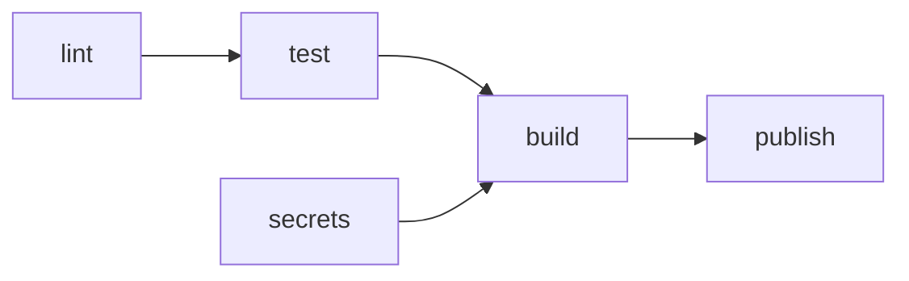

# Материалы для самостоятельного изучения (Воркшоп №5)

**Тема воркшопа:** Философия CI/CD: пайплайны, джобы, артефакты
**Время на подготовку:** около 1 часа 25 минут — 75 минут чтения и 10 минут практической проверки

На воркшопе ваша команда разложит проверки из issue «Ручные проверки перед merge» по местам запуска, разметит шаблон workflow курса и спроектирует свой CI-пайплайн в ADR 004. Workflow в репозиторий на занятии не добавляется: по этому ADR вы создадите его на практике №5. Лекции не будет. Docker на занятии не нужен.

Как читать этот файл: разделы 0–4 — подготовка до занятия. Раздел 5 — рабочие таблицы и команды занятия, заранее его открывать не обязательно. Раздел 6 — домашнее задание.

---

## 0. Что уже должно быть сделано

После практики №4 в вашем репозитории есть `.pre-commit-config.yaml` со сканером секретов из ADR 003, а ruleset `protect-main` (GitFlow — и `protect-develop`) требует PR и approval, но правило **Require status checks to pass** в нём выключено. **Не включайте его** до практики №5: проверять пока нечем.

Главный вход занятия — issue «Ручные проверки перед merge» из домашнего задания 4 практики №4: таблица проверок с командами и **измеренным** временем. Если issue нет или время в нём на глаз — на занятии вы возьмёте готовый перечень из раздела 5.2 и пометите время как «оценка»; issue с замером — домашнее задание 2.

Если у команды на GitFlow релиз `develop` → `main` ещё не сделан (домашнее задание 2 практики №4) — это не мешает: факты для ADR берутся из `develop`.

Папку `.github/workflows/` до практики №5 не создавайте и шаблон workflow туда не копируйте.

---

## 1. Обязательно к прочтению (порядок важен)

Материалы 1–7 — на английском. Для чтения на русском используйте встроенный переводчик браузера: YAML и команды от перевода не пострадают. Читайте с открытым issue «Ручные проверки перед merge»: на занятии каждая проверка из него получит место в пайплайне.

| № | Материал | Время | На какие вопросы найти ответ |
|---|---|---|---|
| 1 | [GitHub Docs: Understanding GitHub Actions](https://docs.github.com/en/actions/get-started/understand-github-actions), разделы **Overview** и **The components of GitHub Actions** | 10 мин | Что такое workflow, событие, джоб, шаг, раннер? Где в репозитории лежит workflow? Джобы по умолчанию идут друг за другом или параллельно? |
| 2 | [Martin Fowler: Continuous Integration](https://martinfowler.com/articles/continuousIntegration.html), в разделе **Practices of Continuous Integration** — подразделы **Every Push to Mainline Should Trigger a Build**, **Fix Broken Builds Immediately**, **Keep the Build Fast**; в разделе **Common Questions** — **Can we run a CI Service on our feature branches?** и **How do we do pull requests and code reviews?** | 20 мин | Почему проверка должна запускаться сама на каждое изменение, а не по желанию автора? Сколько, по Фаулеру, может длиться сборка, и зачем делить её на стадии? Чем CI на ветке фичи отличается от CI в смысле Фаулера? |
| 3 | [GitHub Docs: Workflow syntax for GitHub Actions](https://docs.github.com/en/actions/reference/workflows-and-actions/workflow-syntax), разделы **on.<pull_request\|pull_request_target>.<branches\|branches-ignore>**, **permissions**, **jobs.<job_id>.needs** | 10 мин | Фильтр `branches` у `pull_request` — это ветка, **из** которой PR, или ветка, **в** которую? Что будет с джобом, у которого `needs: lint`, если `lint` упал? Какие права получит токен, если в `permissions` указано только `contents: read`? |
| 4 | [GitHub Docs: Troubleshooting required status checks](https://docs.github.com/en/pull-requests/collaborating-with-pull-requests/collaborating-on-repositories-with-code-quality-features/troubleshooting-required-status-checks) целиком и [Available rules for rulesets](https://docs.github.com/en/repositories/configuring-branches-and-merges-in-your-repository/managing-rulesets/available-rules-for-rulesets), раздел **Require status checks to pass before merging** | 10 мин | Что будет с PR, если обязательная проверка не запустилась вовсе? Почему не стоит делать обязательным workflow, который может быть пропущен фильтром веток? |
| 5 | GitHub Docs: [Workflow artifacts](https://docs.github.com/en/actions/concepts/workflows-and-actions/workflow-artifacts) и [Dependency caching](https://docs.github.com/en/actions/concepts/workflows-and-actions/dependency-caching), в обоих — раздел **Artifacts versus dependency caching** | 10 мин (по 5) | Чем артефакт отличается от кэша? Что в вашем будущем пайплайне — кэш, а что — артефакт? |
| 6 | [GitHub Docs: Using workflow run logs](https://docs.github.com/en/actions/how-tos/monitor-workflows/use-workflow-run-logs), разделы **Viewing logs to diagnose failures** и **Searching logs** | 5 мин | Как найти шаг, на котором упал джоб? Где видно, сколько шёл каждый шаг? |
| 7 | [GitHub Docs: Working with the Container registry](https://docs.github.com/en/packages/working-with-a-github-packages-registry/working-with-the-container-registry), разделы **About the Container registry** и **Authenticating in a GitHub Actions workflow** | 5 мин | Как называется образ в реестре GitHub? Чем workflow входит в реестр, если пароля у него нет? |
| 8 | Шаблон курса [`github-actions-template.yml`](github-actions-template.yml): шапка и джобы `lint`, `secrets` | 5 мин | Какие проверки из вашего issue в нём есть? Каких нет? |

**Материалы 3 и 4 читайте вместе.** Из них следует главное требование к схеме пайплайна. Обязательная проверка ruleset — это имя проверки в PR; у GitHub Actions это имя джоба. Если workflow не запустился совсем — например, ветки PR нет в фильтре `branches`, — PR ждёт эту проверку без конца. Джоб, пропущенный из-за `if` или упавшего `needs`, считается успешным, поэтому обязательной делают каждую стадию, а не только последнюю.

**GitLab CI не читайте.** Курс работает на GitHub; устройство пайплайна (стадии, джобы, артефакты) в GitLab то же, но синтаксис другой.

---

## 2. Практическая проверка (10 мин)

**Шаг 1.** Откройте шаблон [`github-actions-template.yml`](github-actions-template.yml) рядом с issue «Ручные проверки перед merge». Для каждой проверки из issue найдите строку шаблона, которая её заменит, или отметьте для себя: «в шаблоне нет». Записывать не нужно — на занятии это станет приложением Б к ADR 004.

**Шаг 2.** Один раз запустите линтер ruff по своему коду, **не добавляя его в проект**. В корне репозитория, на основной ветке разработки (`main`, GitFlow — `develop`):

```bash
# uv
uvx ruff@0.17.1 check .
# Poetry, pipx установлен
pipx run --spec ruff==0.17.1 ruff check .
# Poetry в venv/ без pipx: venv/ активен
pip install ruff==0.17.1
ruff check .
```

Первый запуск скачивает ruff (около 10 МБ) — запустите команду второй раз и замерьте время:

```bash
# macOS / Linux / Git Bash
time uvx ruff@0.17.1 check .
```

```powershell
# Windows PowerShell: вывод ruff, затем время в секундах
Measure-Command { uvx ruff@0.17.1 check . | Out-Default } | Select-Object -ExpandProperty TotalSeconds
```

Poetry-командам — та же обёртка вокруг своей команды из первого блока.

**Ожидаемый вывод:** либо `All checks passed!`, либо список замечаний вида

```
F401 [*] `os` imported but unused
 --> main.py:1:8
...
Found 1 error.
[*] 1 fixable with `--fix`.
```

В bash время — строка `real`, в zsh (оболочка macOS по умолчанию) — число перед словом `total`, в PowerShell — число секунд последней строкой.

**Как проверить:** `git status --short` выводит то же, что до запуска: ruff ничего не меняет без `--fix`, а папку `.ruff_cache/` git не видит — внутри неё свой `.gitignore`.

Допишите строку в таблицу issue «Ручные проверки перед merge»: проверка «ruff check», команда, измеренное время, «никто» в колонке «Кто запускает сейчас», в «Что ловит» — число замечаний. **Ничего не исправляйте и не коммитьте:** `--fix` не запускайте, линтер в проект не добавляйте — это практика №5.

**Шаг 3.** Ответьте себе на вопрос, проверять не нужно — проверим на воркшопе вместе: если в CI запустить `pre-commit run --all-files` с вашим `.pre-commit-config.yaml`, проверит ли он секреты? Подсказка — шаг 3.3 практики №4.

---

## 3. Вопросы для самопроверки

На воркшопе эти вопросы отдельно не разбираются: на них опирается работа в командах. Если на какой-то вопрос нет ответа, вернитесь к материалу из таблицы.

1. Назовите три способа, которыми коммит попадает в ваш репозиторий, не пройдя pre-commit. Какой из них остановит CI?
2. Workflow запускается по `pull_request` с `branches: [main]`. Команда на GitFlow открывает PR из ветки фичи в `develop`. Что запустится? Что покажет PR, если в ruleset `develop` эта проверка обязательна?
3. В пайплайне джобы `lint`, `test` и `build`; у `test` и `build` — `needs: lint`. `lint` упал. Что будет с `test` и `build`? Что изменится, если все проверки сложить в один джоб?
4. Обязательная проверка ruleset называется `lint`. Вы переименовали джоб в `linters`. Что увидите в PR?
5. Чем артефакт отличается от кэша? Docker-образ, опубликованный в реестр, — это что из двух?
6. Почему публиковать образ разумно только после merge в `main`, а не на каждый PR?
7. Какие права у токена `GITHUB_TOKEN` в шаблоне курса? Почему право записи в реестр дано одному джобу, а не всему workflow?

---

## 4. Что читать сейчас НЕ нужно

Чтобы уложиться в отведённое время, отложите:

- GitLab CI — в курсе не используется;
- pytest, сервис-контейнеры PostgreSQL и миграции в CI — воркшоп №6;
- деплой на сервер из пайплайна — модуль 4;
- matrix-сборки, self-hosted runners, собственные actions и reusable workflows — в курсе не понадобятся;
- настройку ruff и mypy (`[tool.ruff]`, `[tool.mypy]`) — практика №5.

---

## Что понадобится на занятии

- Ноутбук с git и редактором минимум у одного участника, лучше у двух. Docker не нужен
- Локальная копия репозитория команды, основная ветка разработки (`main`, для GitFlow — `develop`) в актуальном состоянии: `git pull`
- Открытый issue «Ручные проверки перед merge» с вашей строкой ruff из раздела 2
- Шаблон ADR из воркшопа №2: [`../workshop2/adr-template.md`](../workshop2/adr-template.md) — по его структуре пишется ADR 004
- Шаблон workflow курса: [`github-actions-template.yml`](github-actions-template.yml)

Связанные документы курса: [Definition of Done](../../definition-of-done.md), раздел 4 «CI/CD пайплайн» — критерии, к которым ведут воркшоп №5 и практики №5–6. Раздел уточнён 2026-10-18 — см. «Историю изменений» в конце этого файла.

---

## 5. Работа на занятии: ADR 004

Итог занятия — один файл в отдельной ветке: `docs/adr/004-ci-pipeline.md` со статусом «Предложено». В «Контексте» — итоги ваших ручных проверок, в «Рассмотренных вариантах» — сравнение трёх устройств пайплайна, в «Решении» — схема джобов. В конце файла — четыре приложения: А — проверки и место запуска, Б — разметка шаблона, В — ревью другой команды, Г — ваши ответы на ревью.

**Чего на занятии не делаете:** не создаёте `.github/workflows/`, не включаете обязательные проверки в ruleset, не добавляете ruff и mypy в зависимости и не меняете `.pre-commit-config.yaml`. Всё это — практика №5 по вашему ADR.

### 5.1. Ветка и файл ADR

Ветка — по вашим правилам именования из `CONTRIBUTING.md`, например `docs/adr-004-ci-pipeline`. Команды на GitFlow создают её от `develop` и открывают PR в `develop`.

```bash
git switch main            # GitFlow: git switch develop
git pull
git switch -c <ветка-по-вашим-правилам>
```

Скопировать шаблон ADR из корня репозитория:

```bash
# macOS / Linux / Git Bash
curl -fsSL --create-dirs -o docs/adr/004-ci-pipeline.md https://raw.githubusercontent.com/andrey-limasov/app-conf/main/workshops/workshop2/adr-template.md
# Windows PowerShell
curl.exe -fsSL --create-dirs -o docs/adr/004-ci-pipeline.md https://raw.githubusercontent.com/andrey-limasov/app-conf/main/workshops/workshop2/adr-template.md
```

**Ожидаемый вывод:** пустой; файл `docs/adr/004-ci-pipeline.md` начинается строкой `# ADR 001: Выбор стратегии ветвления Git` — заголовок вы замените по таблице ниже.

Если ADR у вас называются иначе (например, `docs/adr/adr-001-....md`), назовите файл по своему правилу, номер оставьте 004. Дальше во всех командах `git add` подставляйте свой путь к файлу. Если номер 004 уже занят — возьмите следующий свободный и укажите в описании PR, что это ADR о CI-пайплайне.

**Если в команде два ноутбука:** файл ADR правится только на одном — на том, где создана ветка. Со второго читайте шаблон workflow и свои файлы (`.pre-commit-config.yaml`, `pyproject.toml`, `.python-version`), результаты пересылайте в чат команды. Две правки одного файла в одной ветке дадут конфликт при push.

**Что заменить в шаблоне:**

| Раздел шаблона | Что писать в ADR 004 |
|---|---|
| Заголовок | `# ADR 004: CI-пайплайн` |
| Врезка-цитата под заголовком | Удалить |
| Участники принятия решения | Роли на воркшопе: ведущий ADR, ведущий приложения А, ведущий разметки шаблона (приложение Б), рецензент. Роли можно совмещать |
| Контекст → «Характеристики проекта» | Оставить размер команды и длительность; добавить: стратегия ветвления (ADR 001), менеджер зависимостей и версия Python (ADR 002), сканер секретов и способ его запуска в pre-commit (ADR 003) |
| Контекст → «Уровень опыта команды с Git» | Опыт команды с CI: запускали ли workflow, читали ли логи Actions |
| Контекст → «Требования к стабильности `main`» | Какие ветки защищены и чем (ruleset); что «Require status checks» сейчас выключено; есть ли `.github/CODEOWNERS` и кто владеет `.github/` |
| Контекст → «Проблема» | Итоги приложения А в трёх строках: сколько проверок, сколько из них зависят от человека или клона, сколько минут занимают все вместе. Под ними — «Критерии ADR 004» с доски (выводы демо) |
| Рассмотренные варианты A/B/C | A — pre-commit + ручные проверки, как сейчас; B — один джоб `pre-commit run --all-files` + сборка образа; C — отдельные джобы по стадиям с `needs`. **В начало раздела** — таблица сравнения (раздел 5.4). Блоки «Суть / Плюсы / Минусы / Подходит ли нам» — дома; на занятии только таблица |
| Решение → «Схема ветвления» | «Схема пайплайна»: таблица джобов (раздел 5.4). Диаграмма — по желанию |
| Решение → «Правила работы с ветками» | «Правила пайплайна»: пункты 2–6 «Решения» из раздела 5.4. Правило 6 шаблона «Защита веток» удалить — его заменяет п. 3 «Обязательные проверки» |
| Обоснование → размер команды, частота релизов, опыт, DoD | Критерии из таблицы сравнения, по которым выбранный вариант выигрывает, и какие пункты раздела 4 DoD он закрывает |
| Последствия, Риски и митигация | Оставить структуру, заполнить дома (раздел 6) |
| Связь с другими ADR → «Этот ADR является первым» | ADR 001 — от стратегии зависят триггеры; ADR 002 — как пайплайн ставит зависимости; ADR 003 — какой сканер запускается в CI и откуда берётся версия для тега образа |
| Источники | Материалы этого файла, которыми вы пользовались |
| После «Истории изменений» | Приложения А (раздел 5.2) и Б (раздел 5.3), заготовки приложений В и Г (раздел 5.5). Заготовки В и Г вставьте перед коммитом раздела 5.3 — рецензент заполнит их на месте |

### 5.2. Проверки и место запуска (приложение А)

Таблицу не перепечатывайте. Первые пять колонок бланка совпадают с колонками issue «Ручные проверки перед merge» из домашнего задания 4 практики №4. Откройте issue, в меню описания «…» выберите **Edit**, скопируйте Markdown таблицы в конец ADR под заголовок приложения А и допишите справа четыре колонки: «Место», «Джоб», «Триггер», «Почему здесь». Каждая проверка из issue — строка таблицы. Для каждой выберите место запуска:

| Место | Что значит |
|---|---|
| pre-commit | При каждом `git commit` в клоне, где выполнен `pre-commit install` |
| CI на PR | Workflow на каждый PR в защищённую ветку; результат виден в PR до merge |
| CI после merge | Workflow на push в защищённую ветку — то есть после merge PR |
| Вручную | Остаётся за человеком: CI это не проверит или не должен проверять |

Одна проверка может попасть в два места — тогда это две строки. Например, `pre-commit run --all-files` из issue — это базовые проверки файлов и сканер секретов: у них может оказаться разное место.

```markdown
## Приложение А. Проверки и место запуска

Источник: issue #... «Ручные проверки перед merge» (или: «входного issue нет — перечень раздела 5.2 материалов»).

| Проверка | Команда | Сколько длится | Кто запускает сейчас | Что ловит | Место | Джоб | Триггер | Почему здесь |
|---|---|---|---|---|---|---|---|---|
| Сборка образа | `docker build -t app .` | 2 мин 30 с (измерено) | Тот, у кого работает Docker | Ошибки Dockerfile | CI на PR (практика №6) | `build` | `pull_request` в `main` | Сейчас зависит от ноутбука с Docker; на раннере — одинаково для всех |
|  |  |  |  |  |  |  |  |  |
```

Правила заполнения:

- **Сколько длится** — время из issue, допишите «(измерено)» или «(оценка)». Пусто — нельзя: схема без времени не покажет, через сколько минут команда узнает о проблеме
- **Джоб** — имя джоба из шаблона: `lint`, `secrets`, `test`, `build`, `publish`. Имена закреплены курсом, менять их нельзя: по ним ruleset находит обязательные проверки. Проверке вне CI — «—»
- **Триггер** — событие и ветки: `pull_request` в `main`, `push` в `main`; GitFlow — и `develop`
- **Почему здесь** — одна фраза. Опора — «Критерии ADR 004» с доски
- **Проверки раздела 4 DoD, которых нет в issue**, добавьте строками с пометкой практики в колонке «Сколько длится»: `ruff check`, `ruff format --check` и `mypy` — «практика №5»; `pytest` с PostgreSQL, сборка образа, публикация образа в реестр — «практика №6». Сборка образа у большинства уже есть в issue — тогда не дублируйте

**Нет входного issue** (3 минуты, этап не задерживается). Возьмите перечень из домашнего задания 4 практики №4 — эти пять проверок вы запускали перед merge. В колонке «Сколько длится» — «(оценка)»; issue с замером — домашнее задание 2. Скопируйте перечень в бланк и допишите остальные колонки:

| Проверка | Команда |
|---|---|
| Секреты и базовые проверки | `pre-commit run --all-files` |
| Сборка образа | `docker build -t app .` |
| Стек поднимается | `docker compose up --build -d` |
| Приложение и база отвечают | `curl -i http://localhost:8000/health` (Windows PowerShell: `curl.exe -i ...`) |
| Сканер не пропускает ключ | Проба фиктивным ключом, шаг 3.5 практики №4 |

**Если команда пропустила практику №4** и pre-commit у вас нет — в колонке «Кто запускает сейчас» так и пишите: «никто». Схема строится так же.

Коммит приложения А. Коммит делает тот, за чьим ноутбуком идёт работа; если это не ваш ноутбук — укажите автора, чтобы работа сокомандника попала в историю. Email — тот, что привязан к аккаунту GitHub (GitHub → Settings → Emails):

```bash
git add docs/adr/004-ci-pipeline.md
git commit -m "docs: add manual checks inventory to ADR 004"
# не свой ноутбук: git commit --author="Имя Фамилия <email-из-GitHub>" -m "docs: add manual checks inventory to ADR 004"
```

### 5.3. Разметка шаблона (приложение Б)

Откройте [`github-actions-template.yml`](github-actions-template.yml) и пройдите его сверху вниз. Для каждого элемента из таблицы ниже запишите: какую проверку из приложения А он заменяет (название из колонки «Проверка») или «нового, в issue нет», и что в нём придётся поменять под вашу команду. В джобах `lint` и `secrets` не должно остаться пустых строк: каждая строка этих джобов попадёт в ваш workflow на практике №5.

Что обычно меняется под команду:

| Что | Где в шаблоне | От чего зависит |
|---|---|---|
| Ветки | `on:` → `branches` | Стратегия из ADR 001: GitFlow — `[main, develop]` |
| Менеджер зависимостей | Джоб `lint`: шаги uv или блок Poetry | ADR 002 |
| Версия Python | uv — файл `.python-version`; Poetry — `python-version` у `setup-python` | Ваш `.python-version`, README, `ARG PYTHON_VERSION` в `Dockerfile` |
| Пути к коду | `ruff check .`, `mypy .` | Точка — весь репозиторий: подходит и для `main.py` в корне, и для `app/` |
| Сканер секретов | Джоб `secrets`: gitleaks или detect-secrets | ADR 003. gitleaks, установленный программой (`language: system`), в CI тоже запускается из образа — программы gitleaks на раннере нет |
| Полная история | Джоб `secrets`: блок «вся история» и `fetch-depth: 0` | Ваше решение в «Решении», п. 4 |

```markdown
## Приложение Б. Разметка шаблона github-actions-template.yml

| Элемент шаблона | Заменяет проверку из А (название) или «нового, в issue нет» | Что меняем под команду | Вопрос, если непонятно |
|---|---|---|---|
| `on: pull_request` / `on: push` |  |  |  |
| `permissions: contents: read` |  |  |  |
| `lint`: `actions/checkout` |  |  |  |
| `lint`: установка менеджера (`setup-uv` или блок Poetry) |  |  |  |
| `lint`: Install dependencies |  |  |  |
| `lint`: ruff check |  |  |  |
| `lint`: ruff format --check |  |  |  |
| `lint`: mypy |  |  |  |
| `secrets`: gitleaks (files) или detect-secrets (files) |  |  |  |
| `secrets`: gitleaks (history) и `fetch-depth: 0` |  |  |  |
| `test` (практика №6) |  |  |  |
| `build` (практика №6) |  |  |  |
| `publish` (практика №6) |  |  |  |
```

Колонка «Вопрос» — честная: если строка непонятна, напишите, что именно. Ответ найдёте на практике №5 или спросите у преподавателя при обходе.

**Рецензенту:** за 2 минуты до конца этого этапа прочитайте раздел 5.5 — порядок ревью и три PR для трассировки.

```bash
git add docs/adr/004-ci-pipeline.md
git commit -m "docs: map CI template to manual checks in ADR 004"
# не свой ноутбук: git commit --author="Имя Фамилия <email-из-GitHub>" -m "docs: map CI template to manual checks in ADR 004"
```

### 5.4. Варианты, критерии и решение

Три варианта обязательны:

- **A — pre-commit + ручные проверки, как сейчас.** Честный кандидат: если после сравнения вы его оставите, решение станет обоснованным, а не привычкой. Но тогда в «Обосновании» объясните, как он закрывает раздел 4 DoD
- **B — один джоб, который запускает `pre-commit run --all-files`, + сборка образа.** Повторяет pre-commit в CI
- **C — отдельные джобы по стадиям с `needs`**, как в шаблоне курса

Оценивается обоснование, а не выбор.

Таблица сравнения ставится в начало раздела «Рассмотренные варианты»: строки — критерии, колонки — три варианта. Выберите **минимум пять** критериев. Критерии с доски (выводы демо) — первые кандидаты. Не знаете ответа для какого-то варианта — поставьте в клетку `?` и ссылку из колонки «Где искать»: на занятии такая клетка засчитывается, закрываете её дома.

| Критерий | Где искать |
|---|---|
| Независимость от клона и человека: что будет при коммите через веб-редактор, с `--no-verify`, из клона без `pre-commit install` | Фото доски «Критерии ADR 004» (демо, Д1); практика №4, шаг 3.5; материал 2, **Every Push to Mainline Should Trigger a Build** |
| Что проверка реально проверяет: найдёт ли она секрет в файле, который уже в ветке | Фото доски (Д2); практика №4, шаг 3.3; комментарий над джобом `secrets` в шаблоне |
| Время до первого красного статуса | Фото доски (Д3); приложение А, колонка «Сколько длится»; материал 3, **jobs.<job_id>.needs**; материал 2, **Keep the Build Fast** |
| Понятность лога: видно ли сразу, какая проверка упала | Фото доски (Д3); материал 6 |
| Покрытие веток вашей стратегии | Фото доски (Д4); материал 3, раздел о фильтре `branches` у `pull_request`; материал 4 |
| Имена обязательных проверок ruleset: одна проверка на всё или своя на каждую стадию | Материал 4 |
| Стоимость поддержки: сколько мест править, когда добавится новая проверка | Шаблон; ваш `.pre-commit-config.yaml` |
| Соответствие разделу 4 DoD: стадии, блок merge при красном пайплайне | [Definition of Done](../../definition-of-done.md), раздел 4 |

**«Решение»** — шесть пунктов; на занятии — пункты 1–4 и 6, пункт 5 — дома.

1. **Схема пайплайна** — таблица джобов. Имена и обязательность закреплены курсом: `lint` и `secrets` становятся обязательными проверками ruleset на практике №5, `test` и `build` — на практике №6, `publish` идёт только после merge в `main` и обязательным не бывает. Колонка «Что запускает» заполнена по шаблону курса. Ваши колонки — триггер, от чего зависит (`needs`), сколько длится. Если выбран вариант A или B — таблица описывает ваш вариант: перепишите «Что запускает», а строки, которых в нём нет, пометьте «нет в варианте»

```markdown
**Схема пайплайна**

| Джоб | Стадия | Что запускает | Триггер | `needs` | Время (измерено / оценка) | Обязательная проверка ruleset | Практика |
|---|---|---|---|---|---|---|---|
| `lint` | Линтинг и типы | `ruff check`, `ruff format --check`, `mypy` |  |  |  | Да, с практики №5 | №5 |
| `secrets` | Секреты | gitleaks `dir` из образа или detect-secrets `--baseline`; история — по п. 4 |  |  |  | Да, с практики №5 | №5 |
| `test` | Тесты | `pytest` с сервисом PostgreSQL |  |  |  | Да, с практики №6 | №6 |
| `build` | Сборка образа | `docker build` |  |  |  | Да, с практики №6 | №6 |
| `publish` | Публикация образа | Вход в GHCR, сборка и push образа с тегом |  |  |  | Нет | №6 |
```

2. **Триггеры:** на какие события и ветки запускается пайплайн. GitHub Flow и Trunk-Based — `main`; GitFlow — `develop` и `main` (раздел 4 DoD, уточнение 2026-10-18)
3. **Обязательные проверки:** в каких rulesets они включаются (`protect-main`; GitFlow — и `protect-develop`) и на какой практике
4. **Секреты в CI:** какой сканер и как он запускается в CI; проверяется ли **вся история** и почему. gitleaks: находки истории уже записаны в `.gitleaksignore` на практике №4 — полная проверка их пропустит. detect-secrets историю не смотрит: либо осознанный отказ от проверки истории в CI, либо gitleaks только для истории с собственным `.gitleaksignore`. Оба выбора допустимы, если записаны с причиной
5. **Что остаётся в pre-commit** — дома (домашнее задание 1): pre-commit практики №4 не меняется. Запишите, какие проверки теперь выполняются дважды — при коммите и в CI — и зачем
6. **Реестр и тег образа:** реестр курса — GitHub Container Registry (`ghcr.io/<владелец>/<репозиторий>`, вход по `GITHUB_TOKEN`, отдельные аккаунты не нужны); тег — SHA коммита, версия из источника по ADR 003 или оба. Образ в реестре — артефакт пайплайна; зависимости uv или Poetry, которые переиспользуются между прогонами, — кэш (материал 5)

**Если успеваете:** под таблицей нарисуйте схему диаграммой Mermaid — GitHub показывает её в Markdown-файле картинкой; сравните суммарное время схемы с временем ручных проверок из issue.

````markdown

````

Коммит и первый push ветки ADR. Ключ `-u` связывает локальную ветку с веткой на GitHub: без него первый `git push` новой ветки завершится ошибкой `has no upstream branch`.

```bash
git add docs/adr/004-ci-pipeline.md
git commit -m "docs: propose ADR 004 CI pipeline"
# не свой ноутбук: git commit --author="Имя Фамилия <email-из-GitHub>" -m "docs: propose ADR 004 CI pipeline"
git push -u origin <ваша-ветка>
```

**Как проверить:** `git status` показывает `Your branch is up to date with 'origin/<ваша-ветка>'`; на GitHub ветка видна в списке веток. PR можно открыть сразу, если успеваете; иначе — в домашнем задании 1.

### 5.5. Ревью другой команды (приложения В и Г)

Рецензент заполняет приложение В **прямо в файле авторов**, на их ноутбуке. Авторы коммитят его отдельным коммитом с `--author` рецензента, затем заполняют приложение Г. Вне воркшопа рецензент пишет то же самое комментарием в PR, а авторы переносят его в файл тем же способом.

Главная часть ревью — **трассировка**: рецензент проводит по схеме авторов три PR и для каждого отвечает, что запустится, что упадёт и можно ли будет сделать merge. Отвечать нужно только по тексту ADR, без вопросов авторам. Где схема не дала ответа — это и есть находка.

**Как проверять — 7 минут:**

| Время | Что делать |
|---|---|
| 1 мин | Прочитать «Решение» и приложение А, молча. Вопросов пока не задавать |
| 4 мин | Трассировка трёх PR по таблице ниже. Ответ берёте из схемы; не нашли — пишете в последней колонке, чего не хватило |
| 1 мин | Пройти пять пунктов чек-листа, у каждого — место в ADR |
| 1 мин | До **двух** главных замечаний по формуле или «Блокирующих замечаний нет»; имя и логин |

**Три PR для трассировки.** «Основная ветка разработки» — `main`, у команд на GitFlow — `develop`. Обязательные проверки считайте уже включёнными так, как записано в «Решении», п. 3, — после практики №6.

| PR | Что в нём |
|---|---|
| 1 | Новый файл `client.py` с фиктивным ключом `API_KEY = "..."` (длинная случайная строка). Коммит сделан через веб-редактор GitHub в ветке фичи. PR — в основную ветку разработки |
| 2 | В `main.py` добавлен неиспользуемый импорт `import os`. Больше изменений нет. PR — в основную ветку разработки |
| 3 | PR с правкой `README.md` смержен в `main` (GitFlow — релиз: PR из `develop` в `main` смержен). Что запустится после merge? Появится ли образ в реестре и с каким тегом? |

**Замечание строится по формуле:** где → что не так → чем это грозит → что предлагаете.

| Не замечание | Замечание |
|---|---|
| «Схема непонятная» | «Решение, п. 2: триггер `pull_request` только на `main`, команда работает по GitFlow. PR 2 в `develop` по схеме не запускает ничего — неиспользуемый импорт попадёт в `develop` и всплывёт только на релизе. Предлагаем добавить `develop` в триггеры и обязательные проверки `protect-develop`» |
| «Секреты проверяются плохо» | «Приложение А, строка 1: `pre-commit run --all-files` отнесён в CI как проверка секретов. С ключом `--staged` gitleaks в этом прогоне ничего не сканирует (практика №4, шаг 3.3) — PR 1 пройдёт зелёным. Предлагаем отдельный джоб `secrets` со сканером из образа» |
| «Всё хорошо» — без указания, где проверяли | «PR 3: по схеме `publish` запускается и на PR — образ из непроверенной ветки попадёт в реестр. Предлагаем запускать `publish` только на push в `main`» |

**ADR без замечаний — нормальный результат,** если он доказан: все три PR протрассированы без пробелов, у каждого пункта чек-листа указано место. Выдуманное замечание хуже честного «замечаний нет». Проверяется ADR, а не люди. Не исправляйте файл за авторов.

```markdown
## Приложение В. Ревью другой команды

**Команда-рецензент:** [название]
**Рецензент:** [имя, логин GitHub]

**Трассировка PR по схеме** (без вопросов авторам)

| PR | Какие джобы запустятся | Какой упадёт, какие будут пропущены (skipped) | Merge заблокирован? | Где схема не ответила |
|---|---|---|---|---|
| 1 |  |  |  |  |
| 2 |  |  |  |  |
| 3 |  |  | — (PR уже смержен) | Образ в реестре: да / нет; тег: |

**Чек-лист.** Отметки: ✅ выполнено, ❌ не выполнено, ⚠️ спорно. Для ❌ и ⚠️ комментарий обязателен.

| № | Критерий | Где смотреть | Оценка | Комментарий |
|---|---|---|---|---|
| 1 | В приложении А — все проверки из issue и недостающие проверки раздела 4 DoD; у каждой место, джоб, триггер, время с пометкой «измерено» или «оценка». В приложении Б нет пустых строк в джобах `lint` и `secrets` | Приложение А; issue «Ручные проверки перед merge»; приложение Б, строки `lint`, `secrets` | | |
| 2 | Сравнены 3 варианта (A, B, C) минимум по 5 критериям. Клетка «`?` + ссылка» на занятии засчитывается | «Рассмотренные варианты», таблица | | |
| 3 | В схеме все пять джобов с триггерами, `needs` и обязательностью | «Решение», п. 1 | | |
| 4 | Триггеры и обязательные проверки покрывают ветки стратегии команды (GitFlow — `develop` и `main`) | «Решение», п. 2–3; стратегия — ADR 001 | | |
| 5 | Названы сканер секретов в CI, решение о полной истории с причиной, реестр и тег образа | «Решение», п. 4 и 6 | | |

**Главные замечания** (до двух, по формуле «где → что не так → чем грозит → что предлагаете») или «Блокирующих замечаний нет»:

1.
2.

## Приложение Г. Ответы на ревью

| Замечание или находка трассировки | Что изменили или почему не согласны |
|---|---|
| | |
```

Коммит ревью — от имени рецензента. Email рецензента — тот, что привязан к его аккаунту GitHub (GitHub → Settings → Emails, можно служебный `<id>+<логин>@users.noreply.github.com`):

```bash
git add docs/adr/004-ci-pipeline.md
git commit --author="Имя Фамилия <email-рецензента>" -m "docs: add peer review of ADR 004"
```

Ответы авторов:

```bash
git add docs/adr/004-ci-pipeline.md
git commit -m "docs: respond to peer review of ADR 004"
git push
```

Если ветка ещё ни разу не пушилась (коммит раздела 5.4 пропущен), первый push — `git push -u origin <ваша-ветка>`.

---

## 6. Домашнее задание

| № | Задание | Критерий готовности | Срок |
|---|---|---|---|
| 1 | Дописать ADR 004 | Все разделы шаблона заполнены, включая блоки «Суть / Плюсы / Минусы / Подходит ли нам» у трёх вариантов, п. 5 «Решения» «Что остаётся в pre-commit», «Последствия», «Риски и митигация», «Источники». Приложение А — все проверки issue и проверки раздела 4 DoD, у каждой время; приложение Б — нет пустых строк в джобах `lint` и `secrets`. На каждое замечание и каждую находку трассировки — ответ в приложении Г; статус «Предложено». В «Рисках» — строки, которые относятся к вам: `.github/` в `CODEOWNERS` (PR с workflow на практике №5 ждёт review владельца); репозиторий организации (политика Actions и packages задаётся владельцем организации); нет pre-commit (секреты проверяются только в CI). PR в основную ветку разработки (`main` или `develop` по вашей стратегии) открыт, но **не смержен**: статус «Принято» ADR получит на практике №5, когда workflow заработает. Сокомандник, который не ведущий ADR (не автор коммита `docs: propose ADR 004 CI pipeline`), оставил в PR review (Comment или Approve, без merge) минимум с одним вопросом или замечанием, в том числе к приложению А или Б; авторы ответили на него в PR | К практике №5 |
| 2 | Измерить время ручных проверок | Только если на занятии время было «оценкой» или issue не было: в issue «Ручные проверки перед merge» минимум пять проверок с измеренным временем и строкой ruff из раздела 2; в приложении А ADR 004 «оценка» заменена на «измерено» | К практике №5 |
| 3 | Убедиться, что Actions разрешены | Владелец репозитория открыл **Settings → Actions → General** ([GitHub Docs: Managing GitHub Actions settings for a repository](https://docs.github.com/en/repositories/managing-your-repositorys-settings-and-features/enabling-features-for-your-repository/managing-github-actions-settings-for-a-repository), раздел **Managing GitHub Actions permissions for your repository**, 5 мин) и написал в PR с ADR 004 комментарий: какой вариант выбран в **Actions permissions**. Репозиторий организации — владелец организации подтвердил там же, что политика организации разрешает Actions и публикацию packages | К практике №5 |
| 4 | GitFlow: релиз `develop` → `main` | Напоминание, а не новое задание: если домашнее задание 2 практики №4 не сделано — сделайте его, критерии те же | К практике №5 |

**Если ваша команда пропустила воркшоп целиком:** выполните разделы 5.1–5.4. Ревью (приложение В) напишет комментарием в PR команда, которую назовёт преподаватель; перенесите его в файл и ответьте в приложении Г, как в разделе 5.5.

**Если вы пропустили воркшоп, а команда была:** прочитайте ADR 004 своей команды и ответьте в PR на одно замечание из приложения В. Review сокомандника из задания 1 может быть вашим.

---

## История изменений

| Дата | Что изменилось | Что это значит для команд |
|---|---|---|
| 2026-10-18 | Первая версия | — |
| 2026-10-18 | [Definition of Done](../../definition-of-done.md), раздел 4: пайплайн запускается на каждый PR в основную ветку разработки — `main`, при GitFlow — `develop` и `main`; merge там же блокируется красным пайплайном. Раньше было «PR в `main`» | GitFlow: триггеры пайплайна и обязательные проверки — на обеих ветках (`protect-main` и `protect-develop`). GitHub Flow и Trunk-Based — без изменений |
