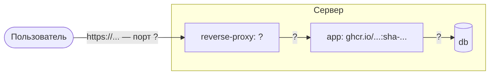
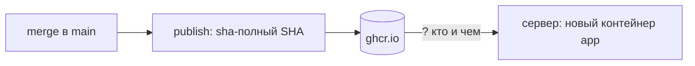

# Материалы для самостоятельного изучения (Воркшоп №7)

**Тема воркшопа:** Стратегии деплоя и наблюдаемость: VPS, reverse-proxy, структурированные логи, health-check
**Время на подготовку:** около 1 часа — 51 минута чтения и 10 минут практической проверки

На воркшопе ваша команда нарисует схему продакшн-окружения своего приложения, сведёт все пункты разделов 5 «Деплой» и 6 «Наблюдаемость» Definition of Done в карту «пункт → решение → как проверим» и спроектирует деплой и наблюдаемость в ADR 006. Сервер, reverse-proxy, HTTPS, структурированные логи и автодеплой на занятии не настраиваются: на практике №7 по этому ADR вы развернёте приложение. Лекции не будет. Своего сервера на занятии не нужно, Docker — тоже.

Как читать этот файл: разделы 0–4 — подготовка до занятия. Раздел 5 — рабочие таблицы и команды занятия, заранее его открывать не обязательно. Раздел 6 — домашнее задание.

---

## 0. Что уже должно быть сделано

После практики №6 и её домашнего задания в вашем репозитории: джобы `lint`, `secrets`, `test`, `build`, `publish`; в **Packages** — образ с тегом `sha-<полный SHA>` коммита в `main`; миграции применяются при старте стека (команда контейнера `app` или сервис `migrate`); ADR 005 «Принято»; issue «Ретроспектива модуля 3» с пунктом «Как проверим на практике №7». Этот образ — то, что практика №7 развернёт на сервере.

Если что-то из этого не готово, воркшоп всё равно проходит: схема и ADR 006 проектируются по тому, что будет, а недостающее записывается строкой «вход не готов» в «Рисках» ADR 006.

| Ситуация | Что делать на воркшопе |
|---|---|
| GitFlow без релиза `develop` → `main` или PR практики №6 ещё не смержен — образа в **Packages** нет | В схеме источник образа тот же: `ghcr.io/...:sha-...` после merge в `main`. GitFlow: ветка ADR — от `develop`, образ — после релиза; релиз — домашнее задание 2 практики №6, срок прежний. PR практики №6 не смержен — закрыть его: домашнее задание 1 практики №6 |
| Миграции при старте стека не сделаны | В п. 4 «Решения» ссылка на п. 2 ADR 005 — способ уже выбран; сделать — домашнее задание 2 практики №6 |
| ADR 005 пока «Предложено» (ревью сдвинулось) | Ссылки на него пишите как «ADR 005 (Предложено)»; ADR 006 от этого не зависит |
| Репозиторий или пакет приватный | См. раздел 2, шаг 3, и домашнее задание 3 |

**Не добавляйте в проект** structlog или loguru, конфигурацию Nginx, Caddy или Traefik и джоб деплоя до практики №7: на занятии вы решите, какие из них и в каком виде войдут в проект.

---

## 1. Обязательно к прочтению (порядок важен)

Все материалы — на английском. Для чтения на русском используйте встроенный переводчик браузера: команды и конфиги от перевода не пострадают. Читайте с открытыми `compose.yaml`, `Dockerfile` и `main.py` своего проекта: на занятии каждый пункт DoD 5–6 получит строку с решением.

| № | Материал | Время | На какие вопросы найти ответ |
|---|---|---|---|
| 1 | [Docker Docs: Start containers automatically](https://docs.docker.com/engine/containers/start-containers-automatically/), разделы **Use a restart policy** и **Restart policy details** | 5 мин | Какие бывают политики перезапуска и чем `always` отличается от `unless-stopped`? Перезапустится ли контейнер, который остановили вручную? Что из «контейнер работает, но отвечает ошибкой» эта страница вообще описывает? |
| 2 | [Docker Docs: Packet filtering and firewalls](https://docs.docker.com/engine/network/packet-filtering-firewalls/), раздел **Docker and ufw**; [Compose: services](https://docs.docker.com/reference/compose-file/services/), разделы [`ports`](https://docs.docker.com/reference/compose-file/services/#ports) и [`expose`](https://docs.docker.com/reference/compose-file/services/#expose) | 10 мин | Что документация Docker говорит о порте, опубликованном через `ports:`, если на сервере межсетевой экран ufw этот порт закрывает? Чем `ports` отличается от `expose`? Как контейнер `app` достучится до `db`, если порт `db` никуда не опубликован? |
| 3 | [Let's Encrypt: How It Works](https://letsencrypt.org/how-it-works/), раздел **Domain Validation**; [Challenge Types](https://letsencrypt.org/docs/challenge-types/), разделы **HTTP-01 challenge**, **DNS-01 challenge** и **TLS-ALPN-01**; [Let's Encrypt: 6-day and IP Address Certificates are Generally Available](https://letsencrypt.org/2026/01/15/6day-and-ip-general-availability/) — абзацы об IP-адресах | 8 мин | Как удостоверяющий центр проверяет, что домен ваш? Какой порт должен быть открыт для HTTP-01? Можно ли получить такой сертификат для сервера без доменного имени — что тогда должно быть доступно из интернета и на какой срок выдаётся сертификат? Почему Caddy (материал 4) сам его на IP-адрес не выпускает? |
| 4 | [Caddy: Reverse proxy quick-start](https://caddyserver.com/docs/quick-starts/reverse-proxy) целиком и [Caddy: Automatic HTTPS](https://caddyserver.com/docs/automatic-https), разделы **Overview** и **Hostname requirements** | 10 мин | Что делает reverse-proxy между пользователем и приложением? Какие условия нужны, чтобы прокси сам получил сертификат? Где в этой схеме заканчивается HTTPS? Caddy здесь — пример с самым коротким конфигом: Nginx и Traefik из DoD 5 решают ту же задачу, выбор — в ADR 006 |
| 5 | [The Twelve-Factor App: XI. Logs](https://12factor.net/logs) | 3 мин | Куда приложение по двенадцати факторам пишет логи? Кто решает, где они хранятся? |
| 6 | [structlog: Context Variables](https://www.structlog.org/en/stable/contextvars.html) целиком; для сравнения — [loguru: `contextualize`](https://loguru.readthedocs.io/en/stable/api/logger.html#loguru._logger.Logger.contextualize) и параметр `serialize` метода `add` на той же странице | 10 мин | Как добавить `request_id` во все строки лога одного запроса, не передавая его в каждую функцию? Где контекст нужно очищать и почему? Что страница structlog предупреждает о FastAPI (Starlette) и смешении синхронного и асинхронного кода? Как loguru выводит запись в JSON? |
| 7 | [FastAPI: Behind a Proxy](https://fastapi.tiangolo.com/advanced/behind-a-proxy/), раздел **Proxy Forwarded Headers** | 5 мин | Почему приложение за прокси «думает», что запрос пришёл по HTTP с адреса прокси? Какой параметр сервера разрешает доверять заголовкам `X-Forwarded-*` и почему по умолчанию сервер не доверяет прокси из соседнего контейнера? У `uvicorn`, которым запускается ваше приложение, это тот же параметр `--forwarded-allow-ips`: какое у него значение по умолчанию (`uvicorn --help`)? |

**Материалы 1–2 читайте вместе со своим `compose.yaml`.** Всё, что в нём опубликовано через `ports:`, на сервере может оказаться доступным из интернета; всё, чем Docker «чинит» упавший контейнер, задаётся политикой перезапуска. Отсюда два вопроса занятия: что открыто наружу и что поднимется само.

**Материал 6 — две библиотеки на равных.** DoD 6 допускает `structlog` и `loguru`; выбор — в п. 7 «Решения» ADR 006. Устанавливать не нужно: ни одной из них в ваших lock-файлах сейчас нет. Документация structlog на странице выше — версии 26.1.0; последняя версия loguru на PyPI на дату подготовки материалов — 0.7.3. Какую версию вы поставите на практике №7, запишите в ADR тогда.

---

## 2. Практическая проверка (10 мин)

Записи этого раздела — вход приложения А на занятии. Ничего не коммитьте, Docker не нужен.

**Шаг 1.** В корне репозитория, на основной ветке разработки (`main`, GitFlow — `develop`), выведите строки, которые решают, что будет открыто наружу и что поднимется само. Если `main.py` лежит в пакете (`app/main.py`), подставьте свой путь.

```bash
# macOS / Linux / Git Bash
grep -n -A2 'ports:' compose.yaml
grep -nE 'restart:|healthcheck:' compose.yaml
grep -n 'HEALTHCHECK' Dockerfile
grep -nE 'import logging|getLogger|logger\.|print\(' main.py
```

```powershell
# Windows PowerShell
Select-String -Path compose.yaml -Pattern 'ports:' -Context 0,2
Select-String -Path compose.yaml -Pattern 'restart:|healthcheck:'
Select-String -Path Dockerfile -Pattern 'HEALTHCHECK'
Select-String -Path main.py -Pattern 'import logging|getLogger|logger\.|print\('
```

**Ожидаемый вывод** — номера строк и сами строки; у типичного проекта после практики №6:

| Что увидите | Что это значит |
|---|---|
| `ports:` и под ним `- "${APP_PORT:-8000}:8000"` | Порт приложения опубликован на машине, где запущен стек |
| Второй `ports:` с `- "5432:5432"` (есть не у всех) | Опубликован порт базы |
| `healthcheck:` — одна строка | Откройте `compose.yaml` на этой строке: под каким сервисом она стоит? У типичного проекта — под `db`: проверка готовности есть только у базы, у `app` в Compose её нет |
| Ни одной строки `restart:` | Политика перезапуска не задана — действует значение по умолчанию (материал 1) |
| `HEALTHCHECK --interval=...` | Проверка `/health` встроена в образ (практика №4) |
| `import logging`, `logging.getLogger("uvicorn.error")`, одна строка `logger.warning(...)` | Логи — стандартный `logging`, без Request ID и без JSON |

Пустой вывод команды — строк нет; это тоже запись. Запишите для себя: какие порты и у каких сервисов опубликованы, есть ли `restart` и `healthcheck` и у кого, чем и что пишет в лог `main.py`.

**Шаг 2.** Откройте ADR 003, приложение А «Параметры конфигурации», колонку `prod` — с воркшопа №4 это гипотеза «что должно быть на сервере». Выпишите параметры, у которых в `prod` значение или правило, и секреты: где они будут храниться на сервере и кто их задаёт. Колонка пустая — запишите «нет», на занятии вы её не заполняете, а ссылаетесь на этот пробел. Колонки или приложения А в ADR 003 нет — запишите «нет» и возьмите параметры из `.env.example` и `compose.yaml`.

**Шаг 3.** Откройте свой репозиторий на GitHub → справа **Packages** → пакет. Запишите полное имя образа (`ghcr.io/<владелец>/<репозиторий>`) и последний тег `sha-...`. Затем откройте страницу пакета в окне браузера в режиме инкогнито: страница открылась — пакет публичный, сервер скачает образ без входа в реестр; 404 — пакет приватный или его нет. Пакета нет (GitFlow без релиза) — запишите «нет образа».

**Как проверить:** `git status --short` выводит то же, что до проверки: команды только читают файлы.

---

## 3. Вопросы для самопроверки

На воркшопе эти вопросы отдельно не разбираются: на них опирается работа в командах. Если на какой-то вопрос нет ответа, вернитесь к материалу из таблицы.

1. На сервере включён ufw, порт 8000 закрыт, а в `compose.yaml` у `app` — `8000:8000`. Откроется ли `http://<сервер>:8000/docs` из интернета? Что об этом говорит материал 2?
2. `/health` возвращает `503`, `HEALTHCHECK` пометил контейнер `unhealthy`, у сервиса `restart: unless-stopped`. Найдите в материале 1, при каком событии политика перезапуска срабатывает. Описано ли там событие «контейнер стал unhealthy»?
3. Сервер без доменного имени, только IP-адрес. Какой сертификат можно получить от Let's Encrypt и при каком условии? Что меняется, если сервер из интернета недоступен? Что увидит пользователь в браузере, если прокси выдаст сертификат собственного удостоверяющего центра?
4. Три запроса пришли одновременно, один упал. В логе — строки без общего поля. Как понять, какие строки относятся к упавшему запросу? Что меняет `request_id` в каждой строке?
5. Контейнер пересоздан при обновлении. Где теперь строки лога за вчера, если приложение пишет в stdout, а на сервере ничего больше не настроено? Где они будут, если писать в файл внутри контейнера?
6. В реестре есть теги `sha-<A>` (вчера) и `sha-<B>` (сегодня, с ошибкой). Как вернуть вчерашнюю версию? Получилось бы так же, если бы на сервер всегда ставился `latest`?
7. Приложение за прокси: пользователь открыл `https://...`, а FastAPI в редиректе вернул ссылку `http://...`. Почему? Что об этом говорит материал 7?

---

## 4. Что читать сейчас НЕ нужно

Чтобы уложиться в отведённое время, отложите:

- аренду и настройку сервера, SSH-ключи, ufw, systemd — практика №7;
- конфигурацию Nginx, Caddy или Traefik и выпуск сертификата — практика №7, по вашему ADR 006;
- код логирования, middleware для Request ID, настройку structlog или loguru — практика №7;
- Kubernetes, Docker Swarm, blue-green и canary на нескольких серверах — в курсе не понадобятся;
- Prometheus, Grafana, ELK и другие системы сбора метрик и логов — в курсе не понадобятся: DoD 6 требует «хотя бы просмотр логов на сервере»;
- изменения в `ci.yml` под деплой — практика №7.

---

## Что понадобится на занятии

- Ноутбук с git и редактором минимум у одного участника, лучше у двух. Docker и сервер не нужны
- Локальная копия репозитория команды, основная ветка разработки (`main`, для GitFlow — `develop`) в актуальном состоянии: `git pull`
- Записи практической проверки из раздела 2
- Свои `compose.yaml`, ADR 003 (приложение А) и ADR 005; шаблон ADR из воркшопа №2: [`../workshop2/adr-template.md`](../workshop2/adr-template.md)

Связанные документы курса: [Definition of Done](../../definition-of-done.md), разделы 5 «Деплой» и 6 «Наблюдаемость» — все двенадцать пунктов; раздел 7 — «Инструкция по развертыванию на сервере» и OpenAPI; «Чек-лист для самопроверки перед защитой» — «Приложение доступно по публичному URL», «`/health` возвращает `200 OK`».

---

## 5. Работа на занятии: ADR 006

Итог занятия — один файл в отдельной ветке: `docs/adr/006-production-environment.md` со статусом «Предложено». В «Рассмотренных вариантах» — сравнение трёх способов автодеплоя, в «Решении» — восемь пунктов, на занятии каждый одной-двумя строками. В конце файла — четыре приложения: А — схема продакшн-окружения, Б — карта DoD 5–6, В — ревью другой команды, Г — ваши ответы на ревью.

**Чего на занятии не делаете:** не настраиваете сервер, не пишете конфиги прокси, код логирования и джоб деплоя, не меняете `compose.yaml`, `ci.yml`, `pyproject.toml` и ADR 001–005. Всё это — практика №7 по вашему ADR 006. Связь с прошлыми ADR записывается в ADR 006.

### 5.1. Роли, ветка и файл ADR

**Роли** — сразу, их вы запишете в «Участники» ADR:

| Роль | Что делает на занятии |
|---|---|
| Ведущий ADR | Создаёт ветку и файл, ведёт приложение А, сводит строки других ролей в приложение Б и «Решение», делает коммиты |
| «Сеть» | Пункты DoD 5: reverse-proxy, HTTPS, публичный URL; порты; OpenAPI на сервере |
| «Поставка» | Пункты DoD 5: сервер, переменные окружения на сервере, автодеплой; обновление и откат |
| «Наблюдаемость» | Пункты DoD 5 и 6: перезапуск при падении, health-check, логи, Request ID, куда пишутся логи, мониторинг |
| Рецензент | Работает в одной из ролей выше, на этапе ревью уходит проверять ADR другой команды (раздел 5.5) |

Втроём: «Сеть» совмещается с ведущим ADR, «Наблюдаемость» — отдельный участник: у неё больше всего строк приложения Б. Вдвоём: «Сеть + Поставка» и «Наблюдаемость + ведущий ADR», рецензент — первый.

**Ветка** — по вашим правилам именования из `CONTRIBUTING.md`, например `docs/adr-006-production-environment`. Команды на GitFlow создают её от `develop` и открывают PR в `develop`.

```bash
git switch main            # GitFlow: git switch develop
git pull
git switch -c <ветка-по-вашим-правилам>
```

Скопировать шаблон ADR из корня репозитория:

```bash
# macOS / Linux / Git Bash
curl -fsSL --create-dirs -o docs/adr/006-production-environment.md https://raw.githubusercontent.com/andrey-limasov/app-conf/main/workshops/workshop2/adr-template.md
# Windows PowerShell
curl.exe -fsSL --create-dirs -o docs/adr/006-production-environment.md https://raw.githubusercontent.com/andrey-limasov/app-conf/main/workshops/workshop2/adr-template.md
```

**Ожидаемый вывод:** пустой; файл `docs/adr/006-production-environment.md` начинается строкой `# ADR 001: Выбор стратегии ветвления Git` — заголовок вы замените по таблице ниже.

Если ADR у вас называются иначе (например, `docs/adr/adr-001-....md`), назовите файл по своему правилу, номер оставьте 006. Дальше во всех командах `git add` подставляйте свой путь к файлу. Если номер 006 уже занят — возьмите следующий свободный и укажите в описании PR, что это ADR о продакшн-окружении.

**Если в команде два ноутбука:** файл ADR правится только на одном — на том, где создана ветка. Со второго читайте `compose.yaml`, ADR 003 и материалы, строки пересылайте в чат команды. Две правки одного файла в одной ветке дадут конфликт при push.

**Что заменить в шаблоне:**

| Раздел шаблона | Что писать в ADR 006 |
|---|---|
| Заголовок | `# ADR 006: Продакшн-окружение: деплой и наблюдаемость` |
| Врезка-цитата под заголовком | Удалить |
| Участники принятия решения | Роли на воркшопе: ведущий ADR, «Сеть», «Поставка», «Наблюдаемость», рецензент. Роли можно совмещать |
| Контекст → «Характеристики проекта» | Оставить размер команды и длительность; добавить: стратегия ветвления (ADR 001), менеджер зависимостей (ADR 002), модуль настроек и параметры `prod` (ADR 003), джоб `publish` и тег образа (ADR 004, ADR 005), способ миграций при старте стека (ADR 005, п. 2) |
| Контекст → «Уровень опыта команды с Git» | Опыт команды с серверами: работали ли с Linux по SSH, с reverse-proxy, читали ли логи на сервере |
| Контекст → «Требования к стабильности `main`» | Что проверено до того, как образ попадает в реестр: обязательные проверки ruleset, кто мержит в `main` (GitFlow — релиз) |
| Контекст → «Проблема» | Итоги приложения А в трёх строках: что сейчас опубликовано, чего нет для сервера, что из DoD 5–6 пока не закрыто. Под ними — «Критерии ADR 006» с доски (выводы демо) |
| Рассмотренные варианты A/B/C | Три способа автодеплоя (раздел 5.4). **В начало раздела** — таблица сравнения. Блоки «Суть / Плюсы / Минусы / Подходит ли нам» — дома; на занятии только таблица |
| Решение → «Схема ветвления» | Удалить схему; вместо неё — восемь пунктов «Решения» из раздела 5.4 |
| Решение → «Правила работы с ветками» | Удалить |
| Обоснование → размер команды, частота релизов, опыт, DoD | Критерии из таблицы сравнения, по которым выбранный способ выигрывает, и какие пункты DoD 5–6 он закрывает |
| Последствия, Риски и митигация | Оставить структуру, заполнить дома (раздел 6). Если вход не готов (раздел 0) — уже на занятии строка в «Рисках»: что не готово и к какому сроку |
| Связь с другими ADR → «Этот ADR является первым» | ADR 001 — с какой ветки идёт деплой; ADR 003 — значения колонки `prod` приложения А становятся переменными на сервере, решение о `/docs` в `prod` уточняет п. 8; ADR 004 и ADR 005 — `publish` и тег `sha-` — вход автодеплоя, миграции при старте — п. 2 ADR 005. ADR 001–005 не правятся: строки в их «Истории изменений» — на практике №7 |
| Источники | Материалы этого файла, которыми вы пользовались |
| После «Истории изменений» | Приложения А (раздел 5.2) и Б (раздел 5.3), заготовки приложений В и Г (раздел 5.5). Заготовки В и Г вставьте перед коммитом раздела 5.3 — рецензент заполнит их на месте |

### 5.2. Схема продакшн-окружения (приложение А)

Схема — то, что будет на сервере после практики №7, по вашему `compose.yaml`, ADR 003 и записям практической проверки (раздел 2). Рисуйте Mermaid — GitHub покажет её картинкой — или текстом в блоке кода. Не знаете ответа для элемента — подпись `?`, а вопрос — в таблицу под схемой.

````markdown
## Приложение А. Схема продакшн-окружения

Источник: `compose.yaml`, ADR 003 (приложение А), ветка `main` (GitFlow — `develop`), коммит <короткий SHA>.



| Что | Сейчас (`compose.yaml`, ноутбук) | Будет на сервере | Почему / какой материал |
|---|---|---|---|
| Опубликованные порты `app` |  |  |  |
| Опубликованные порты `db` |  |  |  |
| Порты reverse-proxy | нет прокси |  |  |
| Где лежат значения `prod` и секреты, кто их задаёт |  |  |  |
| Откуда образ `app` и с каким тегом |  |  |  |
| `restart` и `healthcheck` у каждого сервиса |  |  |  |
| Куда пишутся логи и как их посмотреть |  |  |  |
| Кто и чем запускает деплой |  |  |  |
````

На схеме обязательно: путь пользователя от адреса до приложения, каждый порт, открытый наружу, и где заканчивается HTTPS; сервисы `app` и `db` с тем, как они связаны; источник образа (реестр и тег); место файла с переменными `prod`; куда уходят логи; что запускает деплой. Колонка «Сейчас» — из раздела 2, шаг 1; колонка «Будет на сервере» — ваше решение, его пункт «Решения» вы назовёте в приложении Б.

**Если успеваете:** добавьте на схему стрелку деплоя — от merge в `main` до нового контейнера на сервере, с подписью, кто и чем его запускает.

Коммит приложения А. Коммит делает тот, за чьим ноутбуком идёт работа; если это не ваш ноутбук — укажите автора. Email — тот, что привязан к аккаунту GitHub (GitHub → Settings → Emails):

```bash
git add docs/adr/006-production-environment.md
git commit -m "docs: add production environment diagram to ADR 006"
# не свой ноутбук: git commit --author="Имя Фамилия <email-из-GitHub>" -m "docs: add production environment diagram to ADR 006"
```

### 5.3. Карта DoD 5–6 (приложение Б)

Каждый пункт разделов 5 и 6 DoD — строка: каким пунктом «Решения» он закрывается, каким инструментом или способом и как вы на практике №7 проверите, что он закрыт. Роли заполняют свои строки параллельно — каждый в своём черновике или в чате команды, — ведущий ADR сводит их в файл.

```markdown
## Приложение Б. Карта DoD 5–6

| № | Пункт DoD | Роль | Пункт «Решения» | Инструмент или способ | Как проверим на практике №7 (команда → ожидаемый результат) |
|---|---|---|---|---|---|
| 5.1 | Приложение развернуто на сервере (VPS или облако) | «Поставка» |  |  |  |
| 5.2 | Приложение доступно по публичному URL | «Сеть» |  |  |  |
| 5.3 | Настроен reverse-proxy (Nginx / Traefik / Caddy) | «Сеть» |  |  |  |
| 5.4 | Настроен HTTPS (Let's Encrypt или аналог) | «Сеть» |  |  |  |
| 5.5 | Настроены переменные окружения на сервере (не в коде) | «Поставка» |  |  |  |
| 5.6 | Есть скрипт или CI/CD стадия для автоматического деплоя | «Поставка» |  |  |  |
| 5.7 | Приложение перезапускается автоматически при падении (systemd / docker restart policy) | «Наблюдаемость» |  |  |  |
| 6.1 | Настроено структурированное логирование (`structlog` / `loguru`) | «Наблюдаемость» |  |  |  |
| 6.2 | Логи включают: Timestamp; Level; Request ID; Контекст (эндпоинт, пользователь) | «Наблюдаемость» |  |  |  |
| 6.3 | Есть health-check эндпоинт `GET /health` (200 OK, проверяет базу) | «Наблюдаемость» | п. 6 | Эндпоинт есть с практики №4; новое — кто реагирует на `unhealthy` и проверка через прокси после деплоя | `curl -i https://<адрес>/health` → `HTTP/... 200`, тело как в ответе `/health` вашего кода |
| 6.4 | Логи пишутся в файл или отправляются в систему сбора логов | «Наблюдаемость» |  |  |  |
| 6.5 | Есть базовый мониторинг (хотя бы просмотр логов на сервере) | «Наблюдаемость» |  |  |  |
| — | OpenAPI на сервере (DoD 7, «Автоматически генерируется FastAPI») | «Сеть» | п. 8 |  |  |
```

Правила заполнения:

- **Пустых клеток нет.** Не знаете — `?` и ссылка на материал, где искать ответ (раздел 1 или «Где искать» в разделе 5.4); на занятии такая клетка засчитывается, закрываете её дома
- **«Инструмент или способ»** — конкретно: не «прокси», а «Caddy в отдельном контейнере стека»; не «логи», а «structlog, JSON в stdout»
- **«Как проверим»** — команда и то, что она должна вывести. «Работает» — не проверка. Адрес сервера неизвестен — пишите `<адрес>`: как будет устроен сервер практики №7 (адрес, домен, доступ из интернета), курс сообщит до её рассылки
- Строка 6.3 заполнена как образец: пункт DoD 6 о `/health` закрыт практикой №4, эндпоинт не переделывается; на сервере у него новое содержание

**Рецензенту:** за 2 минуты до конца этого этапа прочитайте раздел 5.5 — порядок ревью и три сценария для трассировки.

```bash
git add docs/adr/006-production-environment.md
git commit -m "docs: map DoD deploy and observability to ADR 006"
# не свой ноутбук: git commit --author="Имя Фамилия <email-из-GitHub>" -m "docs: map DoD deploy and observability to ADR 006"
```

### 5.4. Варианты автодеплоя, критерии и решение

Три способа автодеплоя обязательны:

- **A — скрипт на сервере, запуск вручную.** Участник после merge в `main` подключается к серверу по SSH и запускает скрипт: скачать образ с новым тегом, перезапустить стек. Закрывает ли он пункт DoD 5 «скрипт или CI/CD стадия для автоматического деплоя» — объясните в «Обосновании»
- **B — джоб `deploy` в CI после `publish`.** На `push` в `main` после публикации образа джоб подключается к серверу (адрес, пользователь и SSH-ключ — в секретах репозитория) и выполняет те же команды
- **C — сервер сам забирает новый образ.** По расписанию на сервере запускается проверка: появился ли в реестре новый образ, и если да — обновление стека

Оценивается обоснование, а не выбор. У GitFlow деплой во всех трёх — с `main` после релиза: образ публикуется только оттуда.

Как будет устроен сервер практики №7, курс сообщит до её рассылки. Поэтому запишите в «Риски» ADR 006, что выбранный способ и источник сертификата требуют от сервера: какой доступ из интернета и на какие порты (материалы 2–4).

Таблица сравнения ставится в начало раздела «Рассмотренные варианты»: строки — критерии, колонки — три способа. Выберите **минимум пять** критериев. Критерии с доски (выводы демо) — первые кандидаты. Не знаете ответа для какого-то способа — поставьте в клетку `?` и ссылку из колонки «Где искать».

| Критерий | Где искать |
|---|---|
| Через сколько после merge новая версия на сервере и кто это делает | ADR 004 и ADR 005 — время джобов; комментарий-итог шага 7.2 практики №6 — время `publish`; фото доски |
| Какие секреты нужны и где они хранятся (GitHub, сервер), кто их задаёт | ADR 003, приложение А; DoD 2 «Секреты НЕ коммитятся в Git» |
| Нужен ли доступ к серверу из интернета (SSH с раннера GitHub) | Схема (приложение А); материал 2 |
| Связь со стратегией ветвления: с какой ветки и на каком событии деплой | ADR 001; ADR 004 — условие `publish` |
| Как узнаем, что деплой не удался, и где увидим ошибку | Фото доски «Критерии ADR 006»; материал 5 |
| Откат на прошлую версию: сколько шагов, по какому тегу | Фото доски; вопрос 6 раздела 3 |
| Подходит ли для live-demo на защите «от создания PR до развёртывания на сервере» | [Definition of Done](../../definition-of-done.md), «Чек-лист для самопроверки перед защитой» («сценарий live-demo»); формат защиты — [программа курса](../../syllabus.md), раздел «Итоговый проект» |
| Что нужно добавить в проект и поддерживать | Материалы 1, 4 |

**«Решение»** — восемь пунктов, на занятии каждый одной-двумя строками из приложения Б; можно ссылкой на строки Б с инструментом, например: «п. 6 — Б 5.7, 6.3: `restart: unless-stopped`; `unhealthy` смотрит …». Развёрнуто — дома (домашнее задание 1).

1. **Reverse-proxy и HTTPS** — инструмент (Nginx, Traefik или Caddy), где он запущен, откуда сертификат (Let's Encrypt или аналог; что, если у сервера нет доменного имени или он недоступен из интернета), что происходит с запросом на порт 80; как приложение узнаёт исходный протокол и адрес клиента (материал 7)
2. **Порты и сеть** — что опубликовано наружу; как `app` и `db` доступны прокси и друг другу; как это совместить с `compose.yaml` для ноутбука, где `ports:` нужны для разработки
3. **Переменные на сервере** — где лежит файл с переменными `prod` и кто его задаёт; значения — из колонки `prod` приложения А ADR 003; новые параметры (домен, уровень логов) — в модуль настроек с тем же fail fast
4. **Автодеплой** — выбранный способ: что его запускает, с какой ветки, какой тег образа ставится, какие секреты и кто их задаёт; миграции при старте — по п. 2 ADR 005
5. **Обновление и откат** — что видит пользователь во время обновления; где записан тег текущей версии; как вернуть прошлую и за сколько; почему не `latest`
6. **Перезапуск и health-check** — политика `restart` у каждого сервиса; что делает `healthcheck` и кто реагирует на `unhealthy`; как после деплоя проверяется `/health` через прокси
7. **Логи** — библиотека (`structlog` или `loguru`) и версия на дату практики №7, формат (JSON или ключ=значение), поля (время, уровень, `request_id`, метод и путь, пользователь — если есть авторизация), где появляется `request_id` и возвращается ли он клиенту в заголовке; куда пишутся логи (stdout, файл в томе, система сбора), как их смотреть на сервере и сколько они хранятся
8. **OpenAPI на сервере** — один из трёх вариантов: (а) `/docs` в `prod` выключены, как решено на практике №4, схема выгружается файлом `openapi.json` (в репозиторий или артефактом CI), README ссылается на файл и на `/docs` при локальном запуске; (б) `/docs` в `prod` за паролем на прокси (basic auth); (в) `/docs` в `prod` открыты — тогда это отмена решения практики №4, и её причина записывается строкой «Истории изменений» ADR 003 на практике №7. Почему `/docs` выключали — [практика №4](../../practices/practice4/practice-4-guide.md), этап 2: «на сервере они раскрывают всем список эндпоинтов»

**Новая зависимость логирования — запишите в «Последствия» дома.** Команды на uv добавят её одной командой с lock-файлом; команды на Poetry, у которых `Dockerfile` ставит зависимости из `requirements.txt`, после добавления заново выполняют `poetry export` — как с Alembic на практике №6, иначе библиотеки в образе не будет.

**Если успеваете:** под п. 4 нарисуйте путь деплоя диаграммой Mermaid:

````markdown

````

Коммит и первый push ветки ADR. Ключ `-u` связывает локальную ветку с веткой на GitHub:

```bash
git add docs/adr/006-production-environment.md
git commit -m "docs: propose ADR 006 production environment"
# не свой ноутбук: git commit --author="Имя Фамилия <email-из-GitHub>" -m "docs: propose ADR 006 production environment"
git push -u origin <ваша-ветка>
```

**Как проверить:** `git status` показывает `Your branch is up to date with 'origin/<ваша-ветка>'`; на GitHub ветка видна в списке веток. PR можно открыть сразу, если успеваете; иначе — в домашнем задании 1. В PR запустятся обязательные проверки вашего `ci.yml` — ADR их не ломает; `publish` на PR не запускается.

### 5.5. Ревью другой команды (приложения В и Г)

Рецензент заполняет приложение В **прямо в файле авторов**, на их ноутбуке. Авторы коммитят его отдельным коммитом с `--author` рецензента, затем заполняют приложение Г. Вне воркшопа рецензент пишет то же самое комментарием в PR, а авторы переносят его в файл тем же способом.

Главная часть ревью — **трассировка**: рецензент проводит по ADR авторов три сценария первой недели на сервере и для каждого отвечает на вопросы сценария. Отвечать нужно только по тексту ADR, без вопросов авторам. Где ADR не дал ответа — это и есть находка.

**Как проверять — 7 минут:**

| Время | Что делать |
|---|---|
| 1 мин | Прочитать «Решение», п. 1–8, и схему (приложение А), молча. Вопросов пока не задавать |
| 4 мин | Трассировка трёх сценариев по таблице ниже: при С1 открыть п. 6–7 и строки 5.7, 6.3–6.5 приложения Б; при С2 — п. 4–5 и строку 5.6; при С3 — приложение А и п. 1, 2, 8. Ответ берёте из ADR; не нашли — пишете в последней колонке, чего не хватило |
| 1 мин | Пройти пять пунктов чек-листа, у каждого — место в ADR. Не успеваете — пункты 3–5, остальным ⚠️ с комментарием «не успел» |
| 1 мин | До **двух** главных замечаний по формуле или «Блокирующих замечаний нет»; имя и логин |

**Три сценария для трассировки.** Сервер, прокси, логи и деплой считайте уже сделанными так, как записано в ADR, — после практики №7.

| № | Сценарий |
|---|---|
| С1 | В 03:00 база недоступна две минуты, затем снова доступна. Что увидит пользователь на публичном адресе в эти две минуты и после? Что перезапустится само, а что нет? Какие строки будут в логе, где их найти утром и по какому полю связать их с запросами пользователя? |
| С2 | В `main` смержен код с ошибкой (GitFlow — релиз), `/health` нового образа отвечает `503`. Что и когда задеплоится? Кто и как об этом узнает? Как и за сколько вернуть прошлую версию, по какому тегу? |
| С3 | Посторонний человек сканирует порты сервера и открывает `https://<адрес>`. Какие порты ответят? Откроются ли `/docs` или схема OpenAPI? Есть ли в образе или в репозитории значения из файла переменных сервера? |

**Замечание строится по формуле:** где → что не так → чем это грозит → что предлагаете.

| Не замечание | Замечание |
|---|---|
| «Схема непонятная» | «Приложение А: у `db` на сервере оставлен `5432:5432`, а в п. 2 сказано только „закроем ufw“. В С3 сканер может увидеть порт базы — материал 2 о ufw и опубликованных портах. Предлагаем убрать `ports:` у `db` в конфигурации сервера» |
| «С логами слабо» | «Решение, п. 7: логи в stdout, больше ничего. В С1 утром после пересоздания контейнера строк за ночь может не оказаться, а в ADR не сказано, где они хранятся. Предлагаем записать, куда и сколько хранятся логи (DoD 6, пункт о файле или системе сбора)» |
| «Всё хорошо» — без указания, где проверяли | «С2: в п. 4 деплой на каждый `push` в `main`, в п. 5 откат „вернуть прошлую версию“ без тега. Где записан прошлый тег, не сказано — откат займёт поиск по Packages. Предлагаем хранить текущий тег в файле переменных сервера и записать команду отката» |

**ADR без замечаний — нормальный результат,** если он доказан: все три сценария протрассированы без пробелов, у каждого пункта чек-листа указано место. Выдуманное замечание хуже честного «замечаний нет». Проверяется ADR, а не люди. Не исправляйте файл за авторов.

```markdown
## Приложение В. Ревью другой команды

**Команда-рецензент:** [название]
**Рецензент:** [имя, логин GitHub]

**Трассировка сценариев по ADR** (без вопросов авторам)

| № | Что увидит пользователь | Что поднимется само / что делает команда | Что в логе и где / как откатить / что открыто наружу | Где ADR не ответил |
|---|---|---|---|---|
| С1 |  |  | Лог: |  |
| С2 |  |  | Откат: |  |
| С3 |  | — | Порты: ; `/docs`: ; значения `.env` сервера в образе или репозитории: да / нет |  |

**Чек-лист.** Отметки: ✅ выполнено, ❌ не выполнено, ⚠️ спорно. Для ❌ и ⚠️ комментарий обязателен.

| № | Критерий | Где смотреть | Оценка | Комментарий |
|---|---|---|---|---|
| 1 | На схеме: путь пользователя, порты наружу и место окончания HTTPS, `app` и `db`, источник образа с тегом, место переменных `prod`, куда уходят логи, кто запускает деплой; таблица под схемой заполнена | Приложение А | | |
| 2 | Сравнены 3 способа автодеплоя (A, B, C) минимум по 5 критериям. Клетка «`?` + ссылка» на занятии засчитывается | «Рассмотренные варианты», таблица | | |
| 3 | В приложении Б все 12 пунктов DoD 5–6 и строка OpenAPI; у каждой — пункт «Решения» и проверка командой с ожидаемым результатом (или `?` + ссылка) | Приложение Б | | |
| 4 | Наружу — только то, что нужно; `app` и `db` недоступны напрямую; секреты — на сервере, не в образе и не в git; вариант OpenAPI выбран и обоснован | «Решение», п. 1–3, 8; приложение А | | |
| 5 | Названы тег деплоя и способ отката; политика `restart` и кто реагирует на `unhealthy`; библиотека логов, поля, `request_id`, куда пишутся логи | «Решение», п. 4–7 | | |

**Главные замечания** (до двух, по формуле «где → что не так → чем грозит → что предлагаете») или «Блокирующих замечаний нет»:

1.
2.

## Приложение Г. Ответы на ревью

| Замечание или находка трассировки | Что изменили или почему не согласны |
|---|---|
| | |
```

Коммит ревью — от имени рецензента. Email рецензента — тот, что привязан к его аккаунту GitHub (GitHub → Settings → Emails, можно служебный `<id>+<логин>@users.noreply.github.com`):

```bash
git add docs/adr/006-production-environment.md
git commit --author="Имя Фамилия <email-рецензента>" -m "docs: add peer review of ADR 006"
```

Ответы авторов:

```bash
git add docs/adr/006-production-environment.md
git commit -m "docs: respond to peer review of ADR 006"
git push
```

Если ветка ещё ни разу не пушилась (push раздела 5.4 пропущен), первый push — `git push -u origin <ваша-ветка>`.

---

## 6. Домашнее задание

| № | Задание | Критерий готовности | Срок |
|---|---|---|---|
| 1 | Дописать ADR 006 | Все разделы шаблона заполнены, включая блоки «Суть / Плюсы / Минусы / Подходит ли нам» у трёх способов автодеплоя, «Последствия» (в том числе новая зависимость логирования и новые параметры модуля настроек), «Риски и митигация», «Источники». Пункты 1–8 «Решения» развёрнуты так, чтобы по ним можно было настроить сервер на практике №7 без устных пояснений. Приложение А — схема со всеми элементами раздела 5.2; приложение Б — нет клеток с `?`, у каждой строки «как проверим на практике №7» — команда и ожидаемый результат. На каждое замечание и каждую находку трассировки — ответ в приложении Г; статус «Предложено». В «Рисках» — строки, которые относятся к вам: вход не готов (раздел 0); требования выбранного способа и источника сертификата к серверу (раздел 5.4); секреты для автодеплоя задаёт владелец репозитория; GitFlow — деплой только после релиза. PR в основную ветку разработки открыт, но **не смержен**: «Принято» ADR получит на практике №7 в одном PR с кодом, который его реализует. Сокомандник, который не ведущий ADR (не автор коммита `docs: propose ADR 006 production environment`), оставил в PR review (Comment или Approve, без merge) минимум с одним вопросом или замечанием к приложению А или Б; авторы ответили на него в PR | К практике №7 |
| 2 | Закрыть хвосты практики №6 | Напоминание, а не новое задание: домашние задания 1–4 [практики №6](../../practices/practice6/practice-6-guide.md) — миграции при старте стека, GitFlow — релиз и образ `sha-` в **Packages**, тест-план и покрытие, тесты у каждого участника, «Принято» у ADR на ревью. Сроки у них прежние и к моменту чтения уже прошли: это напоминание о просроченном, не закрытое преподаватель отметил в ведомости | Прежние сроки практики №6: ДЗ 1 — +3 дня после практики, ДЗ 2–4 — к началу воркшопа №7 |
| 3 | Проверить видимость репозитория и пакета | Владелец репозитория убедился, что репозиторий публичный (DoD 1) и пакет в **Packages** открывается в режиме инкогнито (раздел 2, шаг 3), и написал в PR с ADR 006 комментарий: имя образа и его видимость. Пакет приватный при публичном репозитории — владелец делает его публичным в настройках пакета ([GitHub Docs: Configuring a package's access control and visibility](https://docs.github.com/en/packages/learn-github-packages/configuring-a-packages-access-control-and-visibility)); сделать его снова приватным нельзя — по DoD 1 это и не нужно. Публичный пакет GHCR скачивается без входа, и серверу не нужен вход в реестр. Репозиторий нельзя сделать публичным или смена видимости пакета недоступна (политика организации; видимость пакета организации меняет её владелец) — напишите об этом в PR и согласуйте с преподавателем до практики №7 ([DoD](../../definition-of-done.md), примечание 2); тогда серверу понадобится вход в GHCR — запишите это в «Рисках» ADR 006 | К практике №7 |

**Если ваша команда пропустила воркшоп целиком:** выполните разделы 5.1–5.4. Ревью (приложение В) напишет комментарием в PR команда, которую назовёт преподаватель; перенесите его в файл и ответьте в приложении Г, как в разделе 5.5.

**Если вы пропустили воркшоп, а команда была:** прочитайте ADR 006 своей команды и ответьте в PR на одно замечание из приложения В. Review сокомандника из задания 1 может быть вашим.

---

## История изменений

| Дата | Что изменилось | Что это значит для команд |
|---|---|---|
| 2026-11-10 | Первая версия | — |
